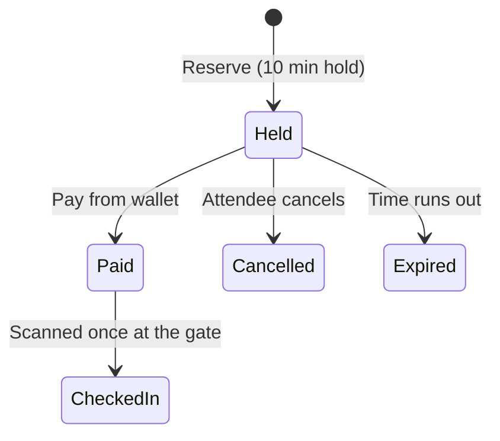

# 🎟️ EventTicketing

**A ticketing platform built around one promise: never sell a ticket that doesn't exist.**

ASP.NET Core 10 · PostgreSQL · React 19 · Built for events in Lagos

<!-- Add your live links here once you've copied the real URLs:
🌐 [Live app](https://YOUR-PAGES-URL) · 📡 [API](https://YOUR-RENDER-URL/swagger)
-->

<!-- Add a hero screenshot here:  -->

---

## Why I built this

Anyone who has watched a popular Lagos event go on sale knows the scene: tickets drop at noon, the site crawls, people pay and get nothing, and the organiser spends the night sorting out refunds.

I wanted to build the system that handles that moment properly. Not a CRUD app with a "tickets" table, but something where thousands of people can reach for the last few tickets at once and the numbers still add up.

Before I wrote any code I wrote a brief: who uses it, what each person can and cannot do, what the numbers look like at peak, and where it could break. The code followed the brief, not the other way round.

---

## What it does

**🎫 Attendees** browse events (no account needed), see live remaining stock, hold a ticket for 10 minutes, pay from a wallet, and keep their ticket with a unique code.

**🎪 Organisers** create events with ticket tiers and early-bird pricing, upload a cover image, submit for approval, publish, and check tickets in at the gate.

**🛡️ Admins** approve or reject events (with a reason), suspend events or organisers, and browse users.

Only an admin approval makes an event public. Organisers cannot publish on their own.

### The life of a ticket



---

## The hard parts, and how I handled them

### 🔒 Never oversell
Remaining stock is calculated, not stored as a counter I'd have to trust:

`remaining = quantity − paid − unexpired holds`

Reserving locks the ticket type's row, counts, and inserts, all in one transaction. In a load test, 20 people going for one ticket produced exactly 1 success and 19 conflicts.

### 💸 Paying twice charges once
Payment requires an `Idempotency-Key`. Retry with the same key and you get the same ticket back. A failed payment doesn't burn the key, so a user can top up and try again.

### ⏱️ Holds expire on their own
A background job flips expired holds every minute. But stock maths ignores expired holds anyway, so correctness never depends on the job running. If the server sleeps for an hour, nobody sees wrong numbers.

### 🔁 One scan per ticket
Check-in is a single conditional update (`WHERE CheckedInAt IS NULL`). Ten simultaneous scans of one code: one success.

### 🔑 Sessions that fail safely
Short-lived access tokens (15 min) plus rotating refresh tokens with a 7-day absolute cap. Replaying an old refresh token revokes the whole session family. Suspending an organiser blocks their existing tokens immediately.

### 🚫 Suspension without rewriting data
Suspending an organiser sets one flag. Public queries hide their events. Nothing is looped and rewritten, and unsuspending is instant.

---

## Decisions worth explaining

| Decision | Why |
|---|---|
| Stock is never cached | The event page is cached, then live stock is laid on top. A stale count can never cause an oversell. |
| Modular monolith, not microservices | One person, one deployable. The layers keep it easy to split later. |
| Roles live in Identity's tables | One source of truth instead of a role column that can disagree. |
| Images in R2, not the database | The database keeps only the object key. Small database, cheap images. |
| No refunds in the MVP | Refunds are a whole feature of their own. Out on purpose. |
| Rate limits from day one | Login, sign-up, reserve, pay, wallet and check-in are all limited. |

---

## Architecture

```text
EventTicketing.Domain          entities, enums, rules (depends on nothing)
        |
EventTicketing.Application     interfaces, DTOs, mapping, cache keys
        |
EventTicketing.Infrastructure  EF Core, Identity, Redis, R2, background jobs
        |
EventTicketing.Api             controllers, auth, rate limits, error shape
```

Dependencies only point inward. Every handled error comes back as `{ code, message, details }`, and stack traces never leave the server.

---

## Tech stack

| | |
|---|---|
| **API** | ASP.NET Core 10, EF Core 10, Npgsql, Mapperly, Asp.Versioning |
| **Auth** | ASP.NET Core Identity (GUID keys), JWT, rotating refresh tokens |
| **Data** | PostgreSQL (Neon), Redis (optional, safe fallback), Cloudflare R2 |
| **Frontend** | React 19, Vite, TypeScript, React Router 7, plain CSS |
| **Tests** | xUnit v3 integration tests, Vitest, Playwright, k6 load tests |
| **Packaging** | Docker multi-stage build |
| **Hosting** | Render (API), Cloudflare Pages (frontend) |

---

## Run it locally

**You'll need:** .NET 10 SDK, Node.js 20+, PostgreSQL (or a Neon database). Redis and an R2 bucket are optional.

```powershell
# Backend
dotnet restore EventTicketing.slnx
dotnet build EventTicketing.slnx

# Secrets (run from the API project folder)
dotnet user-secrets set "ConnectionStrings:DefaultConnection" "<postgres-connection-string>"
dotnet user-secrets set "Jwt:Key" "<at-least-32-random-characters>"
dotnet user-secrets set "Seed:AdminEmail" "<admin-email>"
dotnet user-secrets set "Seed:AdminPassword" "<strong-password>"

# Database
$env:ASPNETCORE_ENVIRONMENT="Development"
dotnet ef database update --project EventTicketing.Infrastructure --startup-project EventTicketing.Api

# Run
dotnet run --project EventTicketing.Api/EventTicketing.Api.csproj --launch-profile http
```

```powershell
# Frontend
cd frontend
npm install
Copy-Item .env.example .env   # points at http://127.0.0.1:5276/api/v1
npm run dev
```

Want sample events? Set `Seed:DemoOrganizerEmail` and `Seed:DemoOrganizerPassword` and the demo seeder adds five published events.

---

## Testing

- **Backend:** 60+ integration tests against a real PostgreSQL, covering auth, workflows, stock races, wallet races and concurrent scans.
- **Frontend:** 38 Vitest tests, plus Playwright flows for public and authenticated journeys.
- **Load (k6):** one ticket and 20 buyers means no oversell. Five requests with one idempotency key means one ticket. Two purchases against a wallet that can afford one means no negative balance.

---

## Honest limitations

- Wallet funding is a **demo feature**. There is no real payment provider.
- No password reset or email delivery yet.

---

## What's next

- [ ] Real payment provider
- [ ] Password reset and email
- [ ] Refunds
- [ ] QR codes for tickets
- [ ] Separate gate-staff role

---

## About

Built by **Taiwo** ([@ErA-16](https://github.com/ErA-16)), a Mathematics student in Lagos teaching himself backend engineering.
